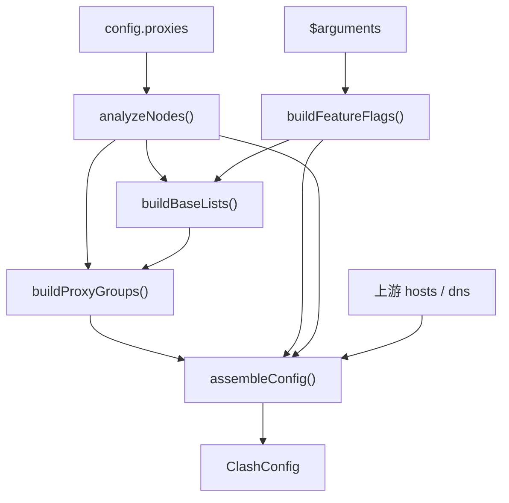

# override-rules 架构文档

本项目为 Mihomo/Clash 订阅覆写工具，保留上游原始节点，生成「直连」「自定义直连」「国外」「AI」四个分流策略，以及规则、DNS 和 TUN 配置。节点分析仅识别链式代理与 Tailscale。

源码分为声明式数据、纯构建逻辑和入口编排三层：`catalog/` 放数据，`builders/` 放无状态构建函数，`main.ts` 编排流程。

## 数据流



`NodeAnalysis` 是节点判定的唯一来源，后续构建函数直接使用分析结果。`GroupBuildContext` 只有 `nodes` 和 `lists`；构建代理组无需接收功能开关。

## 文件职责

| 路径 | 职责 |
| --- | --- |
| `src/main.ts` | 校验输入、读取参数、编排构建、暴露 `globalThis.main` |
| `src/args/schema.ts` | `ARG_DEFAULTS`，所有参数默认值的唯一来源 |
| `src/args/parse.ts` | 将 `ScriptArgs` 解析为 `FeatureFlags` |
| `src/analysis/classify.ts` | 原始出口、前置候选与 Tailscale 识别 |
| `src/catalog/group-names.ts` | 四策略及必要隐藏路由组的名称 |
| `src/catalog/icons.ts` | 图标地址 |
| `src/catalog/service-groups.ts` | 四个可见策略的顺序及候选声明 |
| `src/catalog/custom-direct.ts` | 自定义域名、IP/CIDR、进程条件 |
| `src/catalog/rule-sets.ts` | inline 自定义规则与可选广告规则源 |
| `src/catalog/dns.ts` | DNS 常量 |
| `src/builders/selectors.ts` | `BaseLists`：原始出口与链式前置候选 |
| `src/builders/proxy-groups.ts` | 四策略及按需隐藏路由组 |
| `src/domain/proxy-group.ts` | `selectGroup()`：统一字段顺序、候选展开、空组补 `DIRECT` |
| `src/builders/rules.ts` | 路由顺序与目标策略 |
| `src/builders/dns.ts` | DNS 配置及上游 DNS 字段合并 |
| `src/builders/sniffer.ts` | 域名嗅探配置 |
| `src/builders/tun.ts` | TUN 与路由排除地址 |
| `src/builders/full-config.ts` | `full=true` 时的完整内核参数 |
| `src/builders/geox.ts` | GeoIP/GeoSite/MMDB/ASN 数据源 |
| `src/builders/config.ts` | 最终配置组装 |
| `src/types/` | 参数、代理与 Clash 配置的分域类型 |
| `src/utils/regex.ts` | 已识别节点名的正则转义与精确排除 |
| `src/utils/primitives.ts` | 布尔、数值等通用解析工具 |
| `scripts/build.mjs` | esbuild 打包动态覆写脚本 |
| `scripts/yaml_generator/generator.ts` | 穷举 256 份静态 YAML；支持 `LIMIT_COMBOS` |
| `tests/` | 参数、候选、代理组、规则、DNS/TUN 和组装测试 |

## 节点与代理组

### 原始节点候选

`analyzeNodes()` 保留有名称的节点，并产出：

- `proxyNodes`：所有非 Tailscale 节点，包括链式代理的落地节点，保持订阅顺序。
- `frontProxyNodes`：从 `proxyNodes` 中排除 `dialer-proxy: "前置代理"` 的节点。
- `tailscaleNodes`：`type: "tailscale"` 的节点。
- `hasFrontProxy` 与 `hasTailscale`：从上述数据派生的状态。

`buildBaseLists(nodes, regexFilter)` 生成一份共享 `proxySelector`，供「国外」与「AI」直接使用。默认显式列出原名；`regex=true` 且存在普通节点时改用 `include-all: true`，通过 `exclude-filter` 精确排除已识别的 Tailscale 名称。落地节点始终可以直接作为最终出口。

候选为空时由代理组工厂补 `DIRECT`。启用 `include-all` 的组由内核动态填入节点。此处不生成地区、低倍率、测速、故障转移或单独的手动选择组。

### 四策略分流

`service-groups.ts` 是可见策略的唯一目录，输出顺序固定为：

| 顺序 | 策略 | 候选 |
| --- | --- | --- |
| 1 | 直连 | `DIRECT` |
| 2 | 自定义直连 | 直连、国外 |
| 3 | 国外 | 原始节点 |
| 4 | AI | 原始节点 |

国外与 AI 独立选择出口，默认使用订阅首个节点。脚本不追加显式 `GLOBAL` 组。实时测速后的显示排序属于客户端设置，Clash Party 的 `proxyDisplayOrder: delay` 会按最新延迟升序展示节点，不改变策略顺序与已选出口；覆写脚本无法取得后续测速结果。

### 链式代理

存在 `dialer-proxy: "前置代理"` 的节点时，额外生成隐藏的「前置代理」组，候选为 `DIRECT` 加 `frontProxyNodes`。前置候选排除落地和 Tailscale 节点，防止回到同一前置组形成循环。

订阅全部为落地节点时，国外与 AI 仍直接列出落地节点，前置组仅含 `DIRECT`。没有上述引用时不生成前置组。客户端需支持 `hidden` 才能隐藏辅助路由组。

### Tailscale

存在 Tailscale 节点时，额外生成只含这些节点的隐藏「Tailscale」组，并为 `100.64.0.0/10`、`fd7a:115c:a1e0::/48` 和 `ts.net` 添加定向规则。Tailscale 从国外、AI 与前置候选中排除。

Tailscale 存在时，TUN 不排除对应地址段；不存在时则将其与局域网地址段一起排除。没有 Tailscale 节点时不生成相关代理组和分流规则。

## 路由与自定义直连

`custom-direct.ts` 是自定义清单的唯一来源，通过 `CustomDirect` inline/classical Rule Provider 内嵌到配置，无需下载。域名、IP 和进程条件统一指向「自定义直连」，默认使用「直连」，也可手动切到「国外」。`ruleSet(key, target)` 通过 `RuleSetKey` 约束规则集名称。

路由优先级：自定义直连 → 可选 QUIC 拒绝 → 可选 Tailscale → 内网直连 → 可选广告拒绝 → AI → 国内域名直连 → 国内 IP 直连 → 国外兜底。AI 以外的服务使用国内/国外分类。

自定义清单引用带有 `no-resolve`，IP 条件只使用已知目标地址，域名和进程条件正常匹配。`assembleConfig()` 始终输出 `find-process-mode: strict`，供本机微信等进程规则使用；该设置不依赖 `full` 参数。

## 参数默认值与配置继承

所有默认值集中在 `ARG_DEFAULTS`：`fakeip=true`、`adblock=3`，`ipv6`、`full`、`keepalive`、`quic`、`regex`、`tun` 默认关闭。布尔参数接受 `true`/`false` 或 `1`/`0`。地区与测速分组已移除，对应的 `grouptype`、`loadbalance`、`threshold` 参数一并移除。

配置始终保留上游 `proxies` 与 `hosts`。DNS 合并上游的 `nameserver-policy`、`proxy-server-nameserver-policy`、`proxy-server-nameserver` 和 `fake-ip-filter`，列表去重；增强模式、IPv6、默认 DNS 等核心设置由脚本控制。

## 输出与构建

JS 动态覆写运行时读取真实订阅，支持 URL hash 参数；默认按原名列出节点，也可启用 `regex` 动态纳入额外节点。

静态 YAML 由生成器加载 `convert.js`，使用 `fake_proxies.json` 穷举以下组合：

| 参数 | 可选值 | 数量 |
| --- | --- | --- |
| `ipv6`、`full`、`keepalive`、`fakeip`、`quic`、`tun` | true / false | 各 2 |
| `adblock` | 0 / 1 / 2 / 3 | 4 |

共计 2⁶ × 4 = 256 份，固定 `regex=true`，文件名为：

```text
config_adblock-{0|1|2|3}_ipv6-{0|1}_full-{0|1}_keepalive-{0|1}_fakeip-{0|1}_quic-{0|1}_tun-{0|1}.yaml
```

静态配置依靠 `include-all` 填入实际节点，无法根据真实订阅判定链式代理或 Tailscale，也无法排除生成后新增的 Tailscale 名称；此类场景适合使用 JS。生成前清理已失效的 `config_*.yaml` 命名，删除失败会直接报错。旧的 `config_gt-*` 地址需更新。

两种输出共享 `catalog/` 与 `builders/`。`npm run artifacts` 先构建再生成；产物仅用于本地验证，不提交 `convert.js`、`convert.min.js` 或 `yamls/`。源码推送到 `main` 后由 Preview 工作流更新 `preview`；正式版本按维护者授权流程发布至 `dist`。

类型检查使用 TypeScript 7 原生编译器，ESLint 的类型服务保留 TypeScript 6，esbuild 擦除类型并打包，`tsx` 执行测试和 YAML 生成器。两份 TypeScript 工具各有用途。
